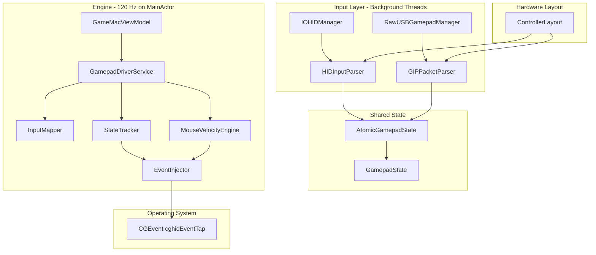

# GameMac — Application Documentation

## 1. Purpose

GameMac solves a specific issue on macOS: generic or third-party gamepads (specifically the **GameSir Kaleid K1** and **GameSir-K1 Controller for Xbox**) are not natively recognized by the OS or games as compatible game controllers.

The application acts as a **hardware bridge**:

1. Reads low-level controller inputs (via HID or raw USB/GIP).
2. Normalizes them into a common semantic state (`GamepadState`).
3. Applies a user mapping profile that translates buttons and sticks into keyboard keys or mouse movements.
4. Inject these events into the operating system using `CGEvent.post`.

It does not create a virtual HID gamepad device; instead, games see synthetic keyboard and mouse inputs.

---

## 2. Project Structure

```
GameMac/
├── App/                    # SwiftUI Entry Point and Lifecycle
│   ├── GameMacApp.swift
│   └── AppDelegate.swift   # Key cleanup on application exit
├── HID/                    # Gamepad discovery, reading, and parsing (no data models)
├── Engine/                 # Semantic mapping, event injection, and GamepadDriverService
├── Models/                 # Pure data models (GamepadState, DeviceInfo, etc.)
├── Profiles/               # Mapping profiles persistence and defaults (ProfileManager)
├── Views/                  # SwiftUI Views and GameMacViewModel
├── Utilities/              # System permissions and logging helpers
├── Resources/
│   ├── Info.plist
│   └── Layouts/            # Hardware-specific JSON layouts matching VID/PID
└── Entitlements/
    └── GameMac.entitlements  # Required entitlements (Sandbox disabled)

setup_project.py            # Generates the Xcode GameMac.xcodeproj with directory nesting
Profiles/                   # Sample JSON profiles (not packaged in the application bundle)
```

---

## 3. Architecture and Data Flow



### Threads and Frequencies

| Component | Thread | Typical Frequency |
|---|---|---|
| `HIDGamepadManager` / `HIDThread` | Dedicated `CFRunLoop` | Device Polling (250–1000 Hz) |
| `RawUSBGamepadManager` | Dedicated `CFRunLoop` | Asynchronous USB pipe read |
| `AtomicGamepadState` | Lock (`OSAllocatedUnfairLock`) | Write from HID/USB; read from engine and UI |
| `GamepadDriverService` (Timer loop) | MainActor | **120 Hz** (Executes input mapping) |
| `MouseVelocityEngine` | Serial Queue `.userInteractive` | **120 Hz** internal updates |
| `ControllerVisualizer` | MainActor | **60 Hz** (throttled in ViewModel) |

### System Coordinators

`GamepadDriverService` ([GamepadDriverService.swift](file:///Users/enriquevazquez/Documents/Developer/GameMac/GameMac/Engine/GamepadDriverService.swift)) is the core hardware orchestrator:
- Instantiates and manages `HIDGamepadManager`, `InputMapper`, and `MouseVelocityEngine`.
- Starts and stops the 120 Hz driver timer.
- Manages IOKit/USB device callbacks and on-the-fly hardware bindings.

`GameMacViewModel` ([GameMacViewModel.swift](file:///Users/enriquevazquez/Documents/Developer/GameMac/GameMac/Views/GameMacViewModel.swift)) coordinates the graphical user interface:
- Exposes reactive properties (`gamepadState`, `isDriverRunning`, etc.) by binding to `GamepadDriverService.shared` via Combine.
- Manages profile CRUD operations and persistence to disk.
- Handles user settings sliders and permission checker triggers.

---

## 4. HID Layer — Detection and Reading

### 4.1 HIDGamepadManager

File: [HIDGamepadManager.swift](file:///Users/enriquevazquez/Documents/Developer/GameMac/GameMac/HID/HIDGamepadManager.swift)

Responsibilities:
- Manages `IOHIDManager` for standard HID gamepads.
- Coordinates `RawUSBGamepadManager` for GameSir-K1 controllers in Xbox mode.
- Tracks connected devices (`hidDevices`, `rawDevices`).
- Selects the active device and loads its specific `ControllerLayout`.
- Forwards raw data packets to the correct input parser.

**HID Matching Criteria** (usage page `0x01`):
- Joystick (`0x04`)
- Gamepad (`0x05`)
- Multi-axis controller (`0x08`)

**Blacklist** ([DeviceBlacklist.swift](file:///Users/enriquevazquez/Documents/Developer/GameMac/GameMac/HID/DeviceBlacklist.swift)): Skips native controllers from Microsoft, Sony, Nintendo, and Apple unless the user toggles **Capture Native** in the status bar.

### 4.2 RawUSBGamepadManager

File: [RawUSBGamepadManager.swift](file:///Users/enriquevazquez/Documents/Developer/GameMac/GameMac/HID/RawUSBGamepadManager.swift)

- Objective: GameSir-K1 Xbox — VID `0x3537`, PID `0x1058`.
- Uses `IOUSBHostDevice` and `IOUSBLib` to open raw USB interfaces.
- Searches for interface **Class 255** (GIP / vendor-specific). Does not attempt to claim the HID interface Class 3 (which is held exclusively by `IOHIDFamily`).
- Reads the USB interrupt pipe asynchronously and parses packets using `GIPPacketParser`.

*(Note: In the current GameSir-K1 hardware firmware, only the HID interface is exposed, so standard execution paths go through HID rather than raw USB).*

### 4.3 Parsers

| Parser | Input | Output |
|---|---|---|
| `HIDInputParser` | `IOHIDValue` + `ControllerLayout` | Updates `GamepadState` |
| `GIPPacketParser` | GIP USB Buffer (type `0x20`) + layout | Updates `GamepadState` |

`HIDInputParser` uses composite keys `(usagePage << 16) | usage` for buttons, with legacy fallback matching for keys `1–11` on page `0x09`.

### 4.4 GamepadState

File: [GamepadState.swift](file:///Users/enriquevazquez/Documents/Developer/GameMac/GameMac/Models/GamepadState.swift)

A normalized Swift struct containing:
- Boolean buttons: `buttonA`, `buttonB`, etc.
- Double axes (sticks: `[-1, 1]`, triggers: `[0, 1]`).
- Connection flags.

`AtomicGamepadState` ([AtomicGamepadState.swift](file:///Users/enriquevazquez/Documents/Developer/GameMac/GameMac/HID/AtomicGamepadState.swift)) wraps the state using `OSAllocatedUnfairLock` to ensure thread-safe concurrent writes and reads.

---

## 5. Dual-Layer Mapping (Core Concept)

GameMac separates **what a physical button signal means** from **what that button does in a game**.

See [layouts-and-profiles.md](layouts-and-profiles.md) for the detailed JSON layout specifications.

| Layer | Type | Question Answered |
|---|---|---|
| **Hardware Layout** | `ControllerLayout` | "Which HID usage / GIP bitmask corresponds to button A?" |
| **Mapping Profile** | `MappingProfile` | "Which keyboard key corresponds to button A in this game?" |

Full button press flow for Button A:
```
Physical Press → HID usage 0x090004
  → layout.buttonMap[589828] = "buttonX" (example composite key mapping)
  → GamepadState.buttonX = true
  → profile.buttonMapping["buttonX"] = 49 (macOS Space keycode)
  → CGEvent Space Key Down sent to system
```

---

## 6. Event Injection (Engine)

### 6.1 InputMapper

File: [InputMapper.swift](file:///Users/enriquevazquez/Documents/Developer/GameMac/GameMac/Engine/InputMapper.swift)

- Runs at **120 Hz**.
- Reads the shared state via `atomicState.read()` and detects edge transitions (pressed/released).
- Forwards button states to `StateTracker` and `EventInjector`.
- Sticks:
  - If stick directions are mapped to keyboard keys in the profile, converts deflection into digital keys.
  - If stick deflection is unmapped to keys, it feeds stick coordinates to `MouseVelocityEngine`.

**Special Mouse Codes** in profiles:
- `1000` &rarr; Left Click
- `1001` &rarr; Right Click
- `1002` &rarr; Middle Click

### 6.2 MouseVelocityEngine

File: [MouseVelocityEngine.swift](file:///Users/enriquevazquez/Documents/Developer/GameMac/GameMac/Engine/MouseVelocityEngine.swift)

- Emulates mouse cursor speeds using deflection levels with an exponential curve (`pow`, `sensitivity`).
- **Desktop Mode:** Absolute cursor placement within the bounds of `NSScreen`.
- **FPS Mode:** Relative movement deltas via `CGAssociateMouseAndMouseCursorPosition(false)`. Auto-centers the mouse before re-associating to prevent sudden camera jumps.
- Uses `ProcessInfo.beginActivity` to prevent macOS from putting the app's threads to sleep (App Nap).

### 6.3 StateTracker

File: [StateTracker.swift](file:///Users/enriquevazquez/Documents/Developer/GameMac/GameMac/Engine/StateTracker.swift)

- Singleton class that tracks active virtual key presses to prevent duplicate `keyDown` events and releases all keys via `flush()` when profiles switch, mandos disconnect, or the app terminates.

### 6.4 EventInjector

File: [EventInjector.swift](file:///Users/enriquevazquez/Documents/Developer/GameMac/GameMac/Engine/EventInjector.swift)

- Wrapper for dispatching events using `CGEventSource(stateID: .hidSystemState)` to `.cghidEventTap`.
- `runDiagnostics()` posts a dummy null event to verify system tap access (used in the Permissions view).

---

## 7. Game Profiles

### Model

`MappingProfile` ([MappingProfile.swift](file:///Users/enriquevazquez/Documents/Developer/GameMac/GameMac/Models/MappingProfile.swift)):
- `profileName: String`
- `buttonMapping: [String: UInt16]`
- `deadZone: Double`, `mouseSensitivity: Double`, `mouseExponent: Double`

### Persistence

`ProfileManager` ([ProfileManager.swift](file:///Users/enriquevazquez/Documents/Developer/GameMac/GameMac/Profiles/ProfileManager.swift)) saves data in JSON format:
```
~/Library/Application Support/GameMac/Profiles/<name>.json
```

### Defaults

`DefaultProfiles.swift` ([DefaultProfiles.swift](file:///Users/enriquevazquez/Documents/Developer/GameMac/GameMac/Profiles/DefaultProfiles.swift)) initializes pre-made profiles:
- **FPS Shooter:** WASD on left stick, mouse aiming on right stick, shooting triggers mapped to mouse clicks.
- **Platformer:** Directional arrows mapped to sticks/D-pad, action buttons to Z and X.
- **RPG:** WASD on left stick, hotbar (1-4) on D-pad, actions (Space, Shift, E, I) on face buttons, skills on bumpers, attack/block on triggers.

---

## 8. User Interface

All interface views live in the `GameMac/Views/` folder. The application is built with a sleek dark theme and is constrained to a minimum window size of 800×520.

| View | Purpose |
|---|---|
| `ContentView` | Navigation shell hosting Mappings, Settings, Dashboard, and Permissions |
| `StatusBar` | Connection status, device selector, daemon toggle, and Capture Native check |
| `ProfileSelectorView` | CRUD operations for saving and selecting profiles |
| `ControllerVisualizer` | High-frequency (60 Hz) visual representation of the active controller state |
| `MappingEditorView` | Mappings list showing physical layouts and active recording modes |
| `SettingsView` | Sensitivity curves, dead zones, and manual axis calibration settings |
| `PermissionView` | System settings shortcuts, permission diagnostic tests |

---

## 9. System Permissions

| Permission | Reason | Check Mechanism |
|---|---|---|
| **Accessibility** | `CGEvent.post` in order to synthesize keyboard/mouse signals | `AXIsProcessTrusted` |
| **Input Monitoring** | Direct low-level USB reads via `IOHIDManager` | `PermissionChecker.checkInputMonitoring()` |

Requires App Sandbox **disabled** ([GameMac.entitlements](file:///Users/enriquevazquez/Documents/Developer/GameMac/GameMac/Entitlements/GameMac.entitlements)).

---

## 10. Hardware Layouts

JSON layouts packaged under `GameMac/Resources/Layouts/`:

| `layoutKey` | Device Name |
|---|---|
| `3537_1012` | GameSir Kaleid K1 |
| `3537_1058` | GameSir-K1 Controller for Xbox |
| `generic` | Generic Fallback Xbox Controller |

`LayoutManager` ([LayoutManager.swift](file:///Users/enriquevazquez/Documents/Developer/GameMac/GameMac/HID/LayoutManager.swift)) loads layouts in the following order:
1. `~/Library/Application Support/GameMac/Layouts/<layoutKey>.json` (user modified layout overrides).
2. App bundle resource files.
3. Hardcoded fallbacks in Swift.
4. `generic` layout.

---

## 11. Axis Calibration

`CalibrationManager` ([CalibrationManager.swift](file:///Users/enriquevazquez/Documents/Developer/GameMac/GameMac/HID/CalibrationManager.swift)) allows developers and users to override raw minimum and maximum values when a controller's descriptors lie about axis limits. Configure in **Settings &rarr; Manual Axis Calibration**.

---

## 12. Build and Compilation

`setup_project.py` builds the workspace project file dynamically:
1. Scans all source folders recursively.
2. Packages layouts JSONs into the application bundle Resources.
3. Outputs `GameMac.xcodeproj` set to target macOS 13.0+ with sandbox disabled.

```bash
python3 setup_project.py
```

Requirements: macOS 13.0+, Xcode, zero external dependencies (CocoaPods/SPM).

---

## 13. Known Limitations

- **Strict Anti-cheat:** Certain multiplayer games inspect USB inputs at the kernel level and block synthetic event taps.
- **Raw GIP USB:** macOS security blocks claiming standard system-level class interfaces. For the current K1, HID mode is highly recommended.
- **Unexpected Termination (SIGKILL):** If the app crashes, OS event queues may retain a key down state. Tap the affected key once on your physical Mac keyboard to release it.
- **One Active Controller:** Only a single gamepad can feed inputs to the mapper daemon at any given time.
